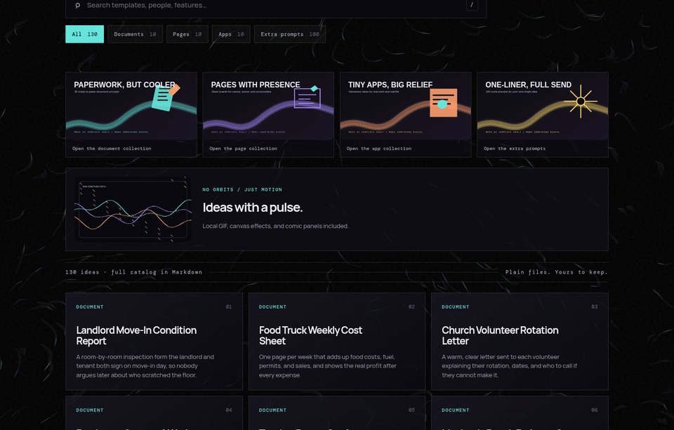
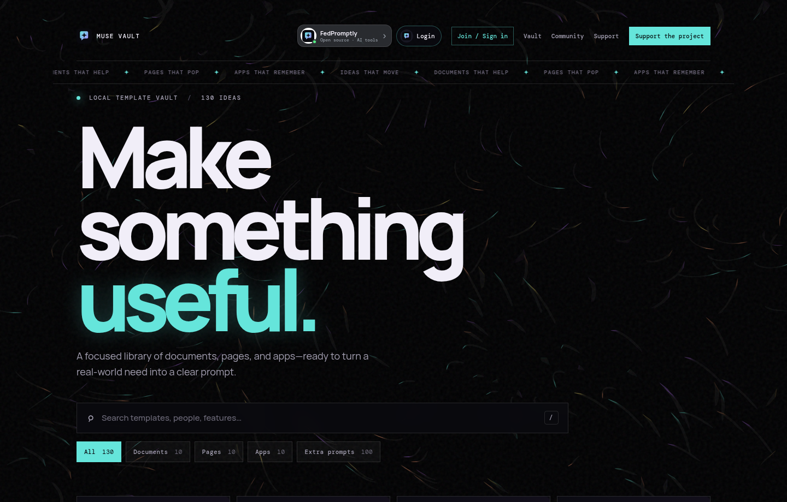
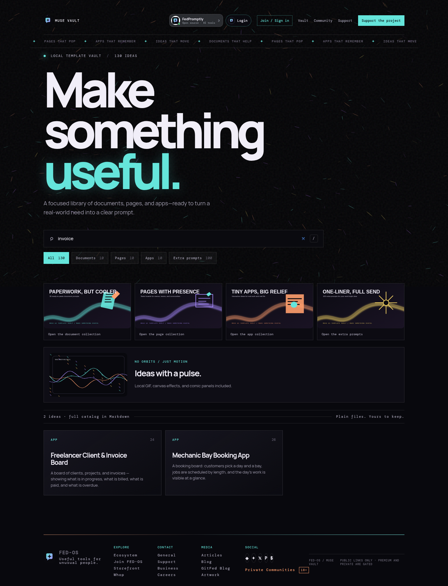
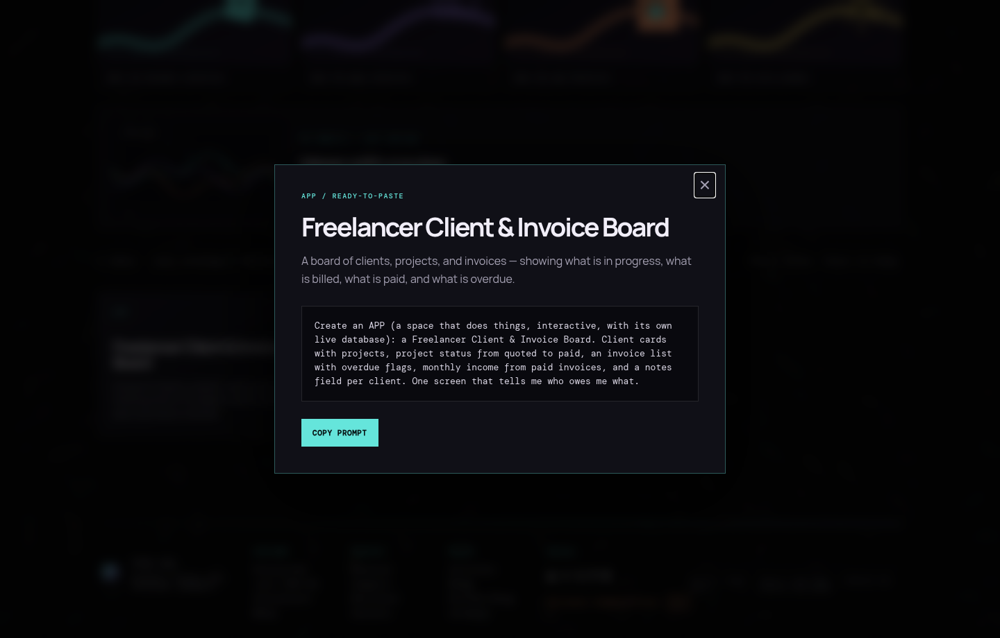

# Muse AI Template Vault

A dark, searchable library of 130 ready-to-paste prompts for turning everyday needs into useful documents, pages, and small apps.


## Why this exists

Most prompt libraries are either a wall of generic ideas or a collection of templates that are hard to search, preview, and reuse. That makes the first useful step—finding the right starting point—slower than it needs to be.

Muse AI Template Vault is for people who want a practical prompt they can paste into an AI builder and adapt immediately: freelancers, small teams, teachers, makers, households, community organizers, and anyone who needs a clear starting structure.

The project is intentionally plain and portable. It is ordinary HTML, CSS, JavaScript, Markdown, SVG, and GIF files—no framework, package manager, build pipeline, Manus-hosted site, or required account for the core explorer. Open it from disk, serve it locally, or publish the repository root as a static site.

## See it work

- **[Open the local explorer](index.html)** — the fastest path to the working demo.
- **[Browse documents](documents.html)** · **[Browse pages](pages.html)** · **[Browse apps](apps.html)** · **[Browse extra prompts](extra-prompts.html)**
- **[Join / sign in](join.html)** and **[support the project](payments.html)** are separate optional pages; the core catalog does not depend on them.



The demo above is captured from the actual explorer. It shows the animated non-orbital background, catalog search, filtered results, prompt detail, and the copy-prompt workflow.

## Screenshots







## Quick start

### Open directly

For the core catalog, open [`index.html`](index.html) in a modern browser. No installation is required.

### Serve locally

A local HTTP server is useful for testing the complete set of relative links and browser behavior:

```bash
cd muse-ai-template-vault
python3 -m http.server 8765
```

Then open <http://127.0.0.1:8765/index.html>.

### Try a real workflow

1. Search for `invoice`.
2. Open **Freelancer Client & Invoice Board**.
3. Review the ready-to-paste APP prompt.
4. Select **COPY PROMPT** and paste it into the AI builder of your choice.
5. Repeat with a document, page, or one of the 100 extra prompts.

There is currently no automated test suite or package-manager command. A practical smoke test is to serve the directory locally, open the explorer, search, open a card, use the copy button, and follow the collection links.

## What is included

| Area | Files | Contents |
| --- | --- | --- |
| Explorer | [`index.html`](index.html), [`app.js`](app.js), [`styles.css`](styles.css), [`site-effects.js`](site-effects.js) | Search, type filters, prompt cards, detail modal, copy action, animated background, ticker, and footer |
| Core catalog | [`documents-10-templates.md`](documents-10-templates.md), [`pages-10-templates.md`](pages-10-templates.md), [`apps-10-templates.md`](apps-10-templates.md), [`100-extra-prompts.md`](100-extra-prompts.md) | The complete 130-prompt source catalog |
| Collection pages | [`documents.html`](documents.html), [`pages.html`](pages.html), [`apps.html`](apps.html), [`extra-prompts.html`](extra-prompts.html) | HTML destinations for each catalog group |
| Community and support | [`community.html`](community.html), [`discord.html`](discord.html), [`support.html`](support.html), [`private-communities.html`](private-communities.html) | Community, support, Discord, and gated private-community flows |
| Optional account flow | [`join.html`](join.html), [`auth-widget.js`](auth-widget.js) | Supabase-backed email-list sign-up/sign-in page and homepage login control |
| Optional funding pages | [`payments.html`](payments.html), [`thanks.html`](thanks.html) | Age-gated payment options and a thanks.dev donation page |
| Visual assets | [`assets/`](assets/) | Symbol favicon, promotional SVG panels, animated ink GIF, local avatar, and demo media |

## Catalog shape

The catalog is split into four useful starting points:

- **10 DOCUMENT prompts** for structured records, checklists, plans, reports, and working sheets.
- **10 PAGE prompts** for public-facing information, boards, lists, and simple sites.
- **10 APP prompts** for interactive tools with workflows, state, and data requirements.
- **100 EXTRA prompts** grouped across practical everyday themes.

Examples include a freelancer client and invoice board, a mechanic bay booking app, a teacher gradebook, a supplier comparison sheet, a family chore board, and a household budget app.

## Static deployment

This repository has no live demo URL configured in the package, and no deployment status is claimed here.

A GitHub Pages workflow is included at [`.github/workflows/pages.yml`](.github/workflows/pages.yml). To use it, push the repository to GitHub, enable **Settings → Pages → Source: GitHub Actions**, and let the workflow publish the repository root. GitHub Pages will then provide the URL assigned by that repository; the URL is intentionally not invented here.

For Cloudflare Pages, create a project from the repository and use the repository root as the published directory. There is no build command and no `wrangler.toml` in this package because the site does not need a build step. Cloudflare Workers Static Assets can also serve the same files, but that deployment configuration is not included.

## Design notes

The explorer uses a near-black canvas with drifting ink-like flow lines, grain, luminous color blooms, a looping ticker, and local comic-style promotion panels. The visual system is deliberately non-orbital. The site remains usable as ordinary local files and keeps internal navigation on HTML pages rather than Markdown-only destinations.

The optional payment and private-community pages include the age and eligibility gates specified for this package. The Ko-fi widget is not included. External services—Supabase authentication, payment providers, Discord, GitHub Sponsors, and the thanks.dev donation CTA—are isolated to their respective optional pages.

## Repository status

This is a standalone static package rather than an installed library. There is no `package.json`, no build system, no automated test runner, and no required runtime dependency for the core catalog. Contributions can be made by editing the Markdown catalog, HTML pages, CSS, JavaScript, or local assets directly.

## License

No license file is currently included. Until a license is added, assume the contents are not licensed for unrestricted reuse and ask the maintainer before redistributing modified versions.


The homepage navigation also includes a local FedPromptly community invite button. It opens a Discord-style information card with contact links and the supplied community CTA at `https://www.fedpromptly.com/social`.
